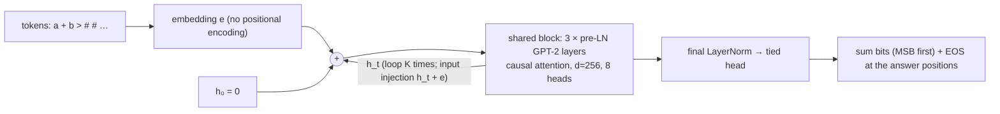
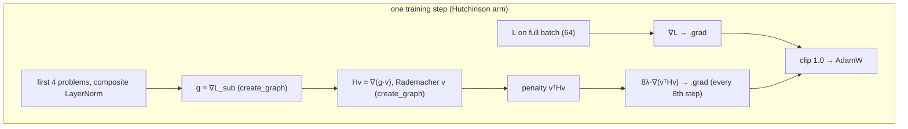

# Hessian-trace regularization for looped transformers

**What this is.** A preregistered experiment. Its question: does penalizing the curvature of the loss while training a looped transformer change how well the model generalizes to longer inputs?

- The curvature measure is the trace of the Hessian, tr(H).
- A **looped transformer** applies one weight-tied block K times, with the input re-injected at every iteration.

**How it works.** Both models are trained on binary addition with operands of 1–19 bits, then tested on 20–60 bits. They are the same 3-layer looped GPT-2 block with the same seed, the same initial weights and the same training batches. One is trained on plain cross-entropy. The other also pays **λ·tr(H)**, computed exactly in expectation with Hutchinson's estimator: double backpropagation for Hv, then a third-order backward pass for the penalty's gradient.

**Motivation.** Two strands of prior work point at this question:
- **Flat minima.** Flat minima are reported to generalize better: [Hochreiter & Schmidhuber 1997](https://doi.org/10.1162/neco.1997.9.1.1); [Keskar et al. 2017](https://arxiv.org/abs/1609.04836); [Jiang et al. 2020](https://arxiv.org/abs/1912.02178). In language models with equal pretraining loss, lower tr(H) comes with better downstream accuracy ([Liu et al. 2023](https://arxiv.org/abs/2210.14199)).
- **Looped models.** They can extrapolate to longer problems by looping more ([Fan et al. 2024](https://arxiv.org/abs/2409.15647)), but this varies a lot across seeds ([Kuo et al. 2026](https://arxiv.org/abs/2606.29983)).

The skeptical literature is built into the design: [Dinh et al. 2017](https://arxiv.org/abs/1703.04933); [Andriushchenko et al. 2023](https://arxiv.org/abs/2302.07011); [Gong et al. 2025](https://arxiv.org/abs/2510.10089).

**Methods.**
- The **exact Hutchinson tr(H) penalty** (as in [SEHT](https://arxiv.org/abs/2208.05924)). It is one of two estimators of the objective L + λ·tr(H).
- The other estimator is **NSO**, [Noise Stability Optimization](https://arxiv.org/abs/2306.08553), which in expectation equals ∇L + (σ²/2)∇tr(H). It is preregistered for Stage 2.

**Status.**
- **Stage 1** (this release): one penalized model vs one plain model, single seed, descriptive only.
- **Stage 2** (preregistered, deferred): 10 seeds, NSO, SAM, compute-matched and random-direction controls, tuning, ablations, and a looped TinyStories language model.

## Highlights

<!-- BEGIN:headline -->
Stage 1 is in progress (finished arms: none).
<!-- END:headline -->

**Other findings:**
- **PyTorch 2.15.0's native `layer_norm` returns wrong third derivatives.** An all-ones probe hides the error. Every other op in the model passes a finite-difference check. Any explicit Hessian-trace penalty through LayerNorm must therefore use a composite implementation. The repro is in [tests/test_third_order.py](tests/test_third_order.py).
- **An exact third-order penalty through 20 loops is expensive on an 8 GB laptop GPU.** Applying it every step costs about 11× a plain step. This forced the penalty onto 4 problems, applied every 8th step with an 8× weight. The deviations are documented before training in the [preregistration addenda](reports/preregistration.md#addenda).


## Results

<!-- BEGIN:results_table -->
Pending.
<!-- END:results_table -->

**More results:**
- Per-length accuracy, loop-count heatmaps, curvature per parameter group, the loop-count curvature study and output examples: [reports/stage1_experiment.md](reports/stage1_experiment.md).
- Paper: [reports/paper/paper.pdf](reports/paper/paper.pdf).
- Interactive explorer: [burnycoder.github.io/hessian-training-for-looped-transformers](https://burnycoder.github.io/hessian-training-for-looped-transformers/).
- Checkpoints: [huggingface.co/BurnyCoder/hessian-looped-transformers](https://huggingface.co/BurnyCoder/hessian-looped-transformers).

## Architecture





## What happens when you run it

`uv run python main.py run --arm hutchinson --name stage1_hutchinson` does the following, logging timestamped lines to the terminal and to `results/<name>/*.log`:

1. **Training data.** Each step draws 64 problem lengths from the curriculum (1 → 19 bits by mid-training), generates random operands and their exact sums, and draws a loop count K_i ∈ [n_i−5, n_i+5] (clamped to [1, 20]) for each problem. All of this comes from one seeded generator, so both arms see identical batches.
2. **Forward pass.** The model loops the shared block until the largest K_i in the batch, reading out each problem's prediction at its own K_i.
3. **Training step.** The step strategy computes the loss gradient. On penalty steps it also adds the Hutchinson penalty gradient. Then come gradient clipping, AdamW and the cosine learning-rate schedule.
4. **Periodic logging.**
   - Every 100 steps: loss, penalty, gradient norm and learning rate go to `history.jsonl`.
   - Every 2000 steps: a 10-probe tr(H) estimate and a quick accuracy check at n ∈ {5, 10, 15, 19, 20, 30, 40}.
5. **Checkpoints.** `init.pt` and `final.pt` are saved to `checkpoints/<name>/`.
6. **Evaluation.** The final and initial models are evaluated on 1000 fixed problems per length (n = 1–19 and 20–60), at every loop count K = 1…n+5, producing `eval.json`, `eval_init.json` and `examples.json`.
7. **Curvature measurement** (`curvature.json`):
   - tr(H) with standard error and per-group block traces;
   - dominant eigenvalue;
   - Fisher trace;
   - adaptive sharpness;
   - weight norms;
   - a loop-count study.

`main.py report` then rebuilds every table and figure in this README, `reports/` and the paper from those files.

## Methodology in detail

| | |
|---|---|
| **Task** | Binary addition in Fan et al.'s full-output-prediction format. Input `a+b>` followed by n+2 placeholders; target is the (n+1)-bit sum, most significant bit first, then EOS. Loss only on answer positions. |
| **Data** | Training lengths n ∈ [1,19], with a linear curriculum. Test: n = 1–19 (ID) and n ∈ {20, 25, …, 60} (OOD), 1000 problems per length, each length with its own seed. |
| **Model** | `LoopedGPT`: 3 pre-LayerNorm GPT-2 layers shared across loops, d=256, 8 heads, MLP 4×, no positional embeddings, causal, tied embeddings, input injection. 2.37M parameters. |
| **Training** | AdamW (lr 1e-4, wd 0.01), cosine decay to 0, batch 64, clip 1.0, 30k steps, fp32 with TF32 matmuls, math SDPA backend. |
| **Penalty** | λ·vᵀH_sub v, λ = 5×10⁻⁵ (σ²/2 at NSO's central σ = 0.01, not tuned). 1 Rademacher probe, 4-problem sub-batch, applied every 8th step with weight 8λ. |
| **Evaluation** | Exact match at every loop count. Stopping rules: oracle (primary), max-confidence (label-free), K = n. |
| **Curvature** | Fixed 128-problem batch at K = n. Hutchinson tr(H) (100 probes, SE), power-iteration eigenvalue, Fisher trace, adaptive sharpness ρ ∈ {0.01, 0.02, 0.05}, weight norms, loop-count study. |
| **Statistics** | Single seed per arm. Wilson CIs and paired McNemar cover test sampling only. Preregistered threshold for a "suggestive" difference: 16.7 points (2·√2 × Kuo et al.'s seed SD). |

Why each choice was made, with sources: [reports/stage1_experiment.md](reports/stage1_experiment.md). The math of the penalty and the estimators: [docs/methods.md](docs/methods.md).

## Installation and usage

You need [uv](https://docs.astral.sh/uv/) and an NVIDIA GPU. The project was developed on an RTX 5070 Laptop (8 GB, sm_120) under Windows 11, with PyTorch 2.15.0+cu132 from the PyTorch index configured in `pyproject.toml`.

```bash
git clone https://github.com/BurnyCoder/hessian-training-for-looped-transformers
```

```bash
cd hessian-training-for-looped-transformers && uv sync
```

Optional: copy `.env.example` to `.env` to change the output paths, the device or the VRAM cap.

Run the tests (estimators vs finite-difference Hessians; third-order autograd per op):

```bash
uv run pytest
```

Run a tiny end-to-end check (a few minutes; writes to `results/smoke/`):

```bash
uv run python main.py smoke
```

Reproduce Stage 1 (about 5 h on the laptop GPU) and regenerate all tables and figures:

```bash
uv run python main.py run --arm baseline --name stage1_baseline
```

```bash
uv run python main.py run --arm hutchinson --name stage1_hutchinson
```

```bash
uv run python main.py report
```

Other phases:
- `benchmark`: throughput and memory per arm.
- `train`, `evaluate`, `measure`: the individual steps of `run`.
- `publish`: upload checkpoints and results to Hugging Face. It needs `hf auth login`.

## Repository layout

| Path | Purpose |
|---|---|
| `main.py` | Single entry point; runs the pipeline phases |
| `src/looped_hessian/data.py` | Addition task, curriculum, randomized loop counts |
| `src/looped_hessian/model.py` | `LoopedGPT`, LayerNorm with a third-order-safe path |
| `src/looped_hessian/regularizers.py` | Training-step strategies: baseline, Hutchinson penalty |
| `src/looped_hessian/linalg.py` | Parameter-space helpers, Hessian-vector product |
| `src/looped_hessian/curvature.py`, `measure.py` | Curvature metrics and the measurement phase |
| `src/looped_hessian/train.py`, `evaluate.py` | Training loop, benchmark, loop-wise evaluation |
| `src/looped_hessian/stats.py`, `report.py`, `plots.py` | Statistics, report and table generation, figures |
| `src/looped_hessian/publish.py` | Hugging Face upload and collection |
| `tests/` | pytest suite |
| `results/` | Per-run JSON, JSONL and logs (source of every number); `results/benchmark/` |
| `reports/` | Preregistration, experiment reports, summary, paper, figures |
| `site/` | Interactive results page (GitHub Pages) |
| `docs/` | Method notes |

## Features and technologies

**Features:**
- Exact third-order Hessian-trace penalty, checked against finite differences.
- Hutchinson trace with standard errors and per-block traces.
- Power iteration, Fisher trace, adaptive sharpness.
- Loop-wise evaluation with three stopping rules.
- Paired single-seed design.
- Preregistration with timestamped addenda.
- Fully generated reports.
- Interactive Plotly site.
- Hugging Face checkpoints.

**Technologies:** Python 3.12, PyTorch 2.15 (autograd double and triple backward, SDPA math backend), NumPy, SciPy, statsmodels, matplotlib, Plotly.js, uv, pytest, GitHub Actions/Pages, Hugging Face Hub.

## Citing and credits

**Code influences:**
- The layer code follows [nanoGPT](https://github.com/karpathy/nanoGPT) (MIT).
- The loop and input-injection design follows [Yang et al. 2024](https://arxiv.org/abs/2311.12424) ([code](https://github.com/Leiay/looped_transformer), MIT) and Fan et al. 2024.
- The power iteration follows [PyHessian](https://github.com/amirgholami/PyHessian) (MIT).

The task and metrics follow Fan et al. 2024 and Kuo et al. 2026. All further sources are cited in the [paper](reports/paper/paper.md).

## License

MIT (see [LICENSE](LICENSE)).
