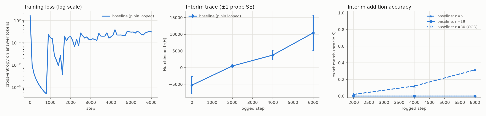

# Hessian-trace regularization for looped transformers

Does a curvature penalty help a transformer trained on short binary additions solve longer ones? A looped transformer reuses the same layers at every iteration. The pilot pairs ordinary cross-entropy training with training that occasionally adds a stochastic estimate of the signed Hessian trace. The outcome of interest is exact addition on longer operands. [Preregistration and amendments](reports/preregistration.md) · [Independent scientific audit](reports/reviews/2026-11-26-scientific-audit.md)

<!-- BEGIN:headline -->
**Stage 1 accuracy comparison and final trace check are unevaluated.** The baseline history ends at logged step 6,000 of a 30,000-step budget and includes interim accuracy checks. No Hutchinson run is recorded.
<!-- END:headline -->

<!-- BEGIN:figures -->

<!-- END:figures -->

The recorded training curves are diagnostics from the indicated arms. The trace error bars measure probe noise on one fixed batch. The quick accuracy curves choose the best loop count on their own labeled examples. [Raw baseline history](results/stage1_baseline/history.jsonl) · [Interactive results](https://burnycoder.github.io/hessian-training-for-looped-transformers/)

## Results

<!-- BEGIN:results_table -->
Final accuracy measurements pending.
<!-- END:results_table -->

The [audit](reports/reviews/2026-11-26-scientific-audit.md) reconstructs the smoke scores, test-set overlap, timing benchmarks and a CPU LayerNorm derivative check. The saved smoke runs exercise the end-to-end pipeline at a reduced training budget. Their outputs are identified separately in the [frozen evidence](results/audit-2026-11-26/). The [paper](reports/paper/paper.pdf) and [experiment report](reports/stage1_experiment.md) distinguish observed measurements from the planned comparisons.

## Design

| Component | Registered design and implementation |
|---|---|
| Data | Each operand has uniformly sampled bits, including leading zeros. The input is two operands, separators, and placeholders. The targets are the most-significant-bit-first sum and EOS. Training uses nominal lengths 1–19. The final OOD lengths are 20, 25, …, 60. Short ID problems can repeat across streams. [Data generator](src/looped_hessian/data.py) · [Run configuration](results/stage1_baseline/config.json) |
| Architecture | Three pre-LayerNorm causal GPT-style layers form one shared block, with width 256, eight heads, no positional embeddings, and a tied embedding/readout. Each iteration adds the input embedding to the previous state. [Implementation](src/looped_hessian/model.py) · [Fan et al., §4 and Appendix F](https://arxiv.org/html/2409.15647) |
| Training | AdamW, cosine learning-rate schedule, gradient clipping, a length curriculum, and randomized per-problem readout depths. Seeded generators control data order, initialization and penalty probes. [Training loop](src/looped_hessian/train.py) · [Kuo et al., Appendix A](https://arxiv.org/html/2606.29983v1#A1) |
| Treatment | On zero-based steps divisible by eight, add the single-probe penalty gradient on the first four problems, scaled by eight times the registered coefficient. The token-mean loss on this sub-batch has its own Hessian. Clipping and AdamW then act on the combined gradient. [Methods and derivation](docs/methods.md) · [SEHT-H](https://arxiv.org/pdf/2208.05924) |
| Evaluation | The primary score averages exact-match rates equally over OOD lengths. The oracle uses one test-selected depth per length. Secondary rules use the batch’s confidence or the fixed depth K=n. Fixed-depth results have test-sampling intervals. [Scoring implementation](src/looped_hessian/evaluate.py) · [Audit of the inference](reports/reviews/2026-11-26-scientific-audit.md) |
| Curvature | The final protocol uses a fixed length-uniform measurement batch at K=n. Measurements include a signed trace, a largest-magnitude eigenvalue estimate, model Fisher trace, adaptive sharpness, and weight norms. [Measurement protocol](docs/methods.md) |

Weight sharing permits depth to grow at inference time. Fan et al. demonstrated length extrapolation on particular algorithmic tasks, and Kuo et al. found appreciable variation across random seeds on addition. Studies of sharpness give reasons to test the idea empirically. A parameter-space trace depends on parameterization and can mix positive and negative curvature. [Fan et al.](https://arxiv.org/html/2409.15647) · [Kuo et al.](https://arxiv.org/html/2606.29983v1) · [Dinh et al.](https://arxiv.org/abs/1703.04933) · [Andriushchenko et al.](https://arxiv.org/abs/2302.07011)


## Reproduce the audit

Install [uv](https://docs.astral.sh/uv/), clone the repository, and run these commands from its root. The lockfile pins Python dependencies, including the configured PyTorch build. PDF generation uses Pandoc, XeLaTeX, Cambria, Cambria Math and Consolas. The existing paper and site are also checked in. [Environment](pyproject.toml) · [Renderer](src/looped_hessian/report.py)

```bash
uv sync --frozen
uv run python main.py report
uv run pytest -q tests/test_stats.py tests/test_data.py tests/test_audit_reporting.py
```

Reporting reads saved JSON/JSONL, verifies the frozen evidence hashes, reconstructs the smoke-to-final input overlap, and rebuilds tables, figures, summary JSON, and the PDF. The listed tests use saved records and mathematical fixtures. The report needs no GPU. [Evidence reconstruction](src/looped_hessian/audit.py) · [SHA-256 manifest](results/audit-2026-11-26/SHA256SUMS)

## Running the registered experiment separately

The experiment entry point samples operand lengths and bits, computes the answer-token loss at each problem’s sampled loop depth, and logs interim loss, trace and exact match. An arm that finishes training can then be evaluated across loop counts and measured for curvature. To run a new pair, set `LH_OUTPUT_DIR=results/replication` and `LH_CHECKPOINT_DIR=checkpoints/replication` in a local `.env`, using fresh directories for each attempt. The entry point preserves existing evidence. Checkpoints contain the initialization and final weights; the recorded partial baseline has an initialization checkpoint locally and no recorded restart state. [CLI](main.py) · [Configuration](src/looped_hessian/config.py)

```bash
uv run python main.py run --arm baseline --name stage1_baseline
uv run python main.py run --arm hutchinson --name stage1_hutchinson
uv run python main.py report
```

The optional `.env` controls output paths, device and the GPU allocator cap. Other phases are `train`, `evaluate`, `measure`, `smoke`, `benchmark`, and `publish`. The ordinary full pytest suite includes model-forward tests. Hugging Face publication requires authenticated access and an evaluated arm. [Environment example](.env.example) · [Publication code](src/looped_hessian/publish.py)

## Research record

- [Experiment index](reports/all_experiments.md), [summary](reports/summary.md), [progress](reports/progress.md), and [future analysis](reports/preregistration.md). The multi-seed Stage 2, its trained controls and the language-model extension are deferred.
- [Method definitions](docs/methods.md), [raw results](results/), [paper source](reports/paper/paper.md), and [scientific audit](reports/reviews/2026-11-26-scientific-audit.md). The implementation uses Python, PyTorch, NumPy, SciPy, statsmodels, matplotlib, Plotly and GitHub Pages.
- Next experimental milestones are a completed paired pilot, its fixed-batch manipulation check, and only then the independently analyzed multi-seed comparisons.

[MIT license](LICENSE).
