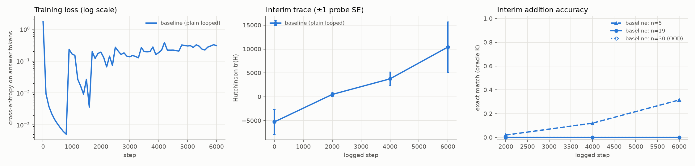

# Abstract

Does adding a parameter-space curvature penalty improve length generalization in a weight-tied transformer? The registered pilot compares two training procedures on binary addition, with data order and initialization paired by seed. The primary endpoint is exact match on longer operands at a loop count selected separately for each length. This paper reports the status of the available artifacts, a reconstruction of the smoke tests, and an isolated numerical check of the third derivative needed by the penalty.

<!-- BEGIN:headline -->
**Stage 1 accuracy comparison and final trace check are unevaluated.** The baseline history ends at logged step 6,000 of a 30,000-step budget and includes interim accuracy checks. No Hutchinson run is recorded.
<!-- END:headline -->

The recorded evidence supports a reporting correction, a finding about evaluation-set reuse, and a version-specific operator result. The treatment effect on accuracy and the final loss curvature remain open. [Evidence, verification code and manifest](https://github.com/BurnyCoder/hessian-training-for-looped-transformers/blob/main/reports/reviews/2026-11-26-scientific-audit.md)

# Motivation and related work

Looped transformers can allocate greater depth to longer inputs. Fan et al. demonstrated length extrapolation on algorithmic tasks. Kuo et al. found that looped addition models with similar in-distribution performance varied across initializations and data order. These results motivate an intervention on the training procedure. They do not predict the sign of its effect. [Fan et al., §6](https://arxiv.org/html/2409.15647) · [Kuo et al., §3–4](https://arxiv.org/html/2606.29983v1)

Hutchinson’s identity provides an unbiased estimate of a matrix trace. Liu, Yu and Lin used this identity in a Hessian-trace regularizer for neural networks, including CNNs and an LSTM. NSO instead estimates the gradient of a noise-smoothed objective. The question here is whether a particular intermittent trace penalty changes a shared-depth transformer’s extrapolation under matched training conditions. This combination specifies the contribution without asserting historical priority. [Hutchinson](https://doi.org/10.1080/03610919008812866) · [SEHT-H](https://arxiv.org/pdf/2208.05924) · [NSO](https://arxiv.org/html/2306.08553v4)

Published associations between curvature and generalization depend on model, training regime and measure. Reparameterizations can change parameter-space sharpness while preserving predictions. Experiments on adaptive sharpness include cases in which sharper solutions have lower OOD error. Gong et al. motivate a steep-valley account for particular looped-attention settings. None of these observations identifies the causal effect in this pilot. [Dinh et al.](https://arxiv.org/abs/1703.04933) · [Andriushchenko et al.](https://arxiv.org/abs/2302.07011) · [Gong et al.](https://arxiv.org/abs/2510.10089)

# Experimental design

## Data, architecture and optimizer

The generator samples two independent width-n bit strings including leading zeros. After the operands and separators it appends n+2 identical placeholders. Supervision covers the n+1 sum bits in most-significant-bit-first order and one EOS. Fan et al.’s implementation places the first sum bit one position earlier and can supervise additional padded EOS positions. Operand widths increase through a linear curriculum up to 19. Final ID evaluation spans 1–19 and the prespecified OOD widths are 20, 25, …, 60. The planned final count is 1,000 per length. [Generator](https://github.com/BurnyCoder/hessian-training-for-looped-transformers/blob/main/src/looped_hessian/data.py) · [Fan et al.’s generator](https://github.com/UW-Madison-Lee-Lab/looped-tf/blob/main/src/generate_training_data.py) · [Resolved settings](https://github.com/BurnyCoder/hessian-training-for-looped-transformers/blob/main/results/stage1_baseline/config.json)

The model reuses a three-layer, pre-LayerNorm causal GPT block, width 256, eight heads, and a fourfold feedforward expansion. It uses no explicit positional embeddings. At each iteration it adds the original embedding to the preceding hidden state. The input embedding and output projection share weights. With e the token embeddings and the initial state zero, the data flow is

$$
h_{t-1}+e \;\longrightarrow\; \boxed{\mathrm{shared\ block}} \;\longrightarrow\; h_t
\;\longrightarrow\; \mathrm{LayerNorm} \;\longrightarrow\; \mathrm{tied\ readout}.
$$

Each example is read at its own training depth, a uniform integer offset from −5 to +5 added to n, then clamped to [1,20]. This creates extra probability mass at clipped endpoints. The shared optimizer is AdamW, initial learning rate 0.0001, cosine decay, batch size 64 and gradient-norm clip 1.0. The step budget and GPU-driven changes are registered in the addenda. [Model](https://github.com/BurnyCoder/hessian-training-for-looped-transformers/blob/main/src/looped_hessian/model.py) · [Kuo et al., Appendix A](https://arxiv.org/html/2606.29983v1#A1) · [Preregistration](https://github.com/BurnyCoder/hessian-training-for-looped-transformers/blob/main/reports/preregistration.md)

## What is regularized

Let $L_B$ be cross-entropy averaged over supervised tokens in batch $B$, and $H_S$ the Hessian of the separately normalized loss on its first four problems. On zero-based steps divisible by eight the raw gradient is $\nabla L_B + 8\lambda\nabla(v^\top H_S v)$, with $\lambda=0.00005$ and a fresh Rademacher vector. The remaining steps use $\nabla L_B$. Two reverse-mode derivatives compute $H_S v$, and a further derivative supplies the penalty gradient. Averaging over probes at a fixed sub-batch and parameters gives the trace gradient for that sub-batch. Different token denominators, changing iterates, clipping and AdamW prevent an equality between sparse and dense optimizer updates. The coefficient uses σ²/2 at σ=0.01 as a design reference from NSO’s ResNet study. [Training strategy](https://github.com/BurnyCoder/hessian-training-for-looped-transformers/blob/main/src/looped_hessian/regularizers.py) · [Derivation](https://github.com/BurnyCoder/hessian-training-for-looped-transformers/blob/main/docs/methods.md) · [NSO, §2–3](https://arxiv.org/html/2306.08553v4)

## Endpoints and inferential units

Exact match requires all answer bits and EOS. At each length the oracle chooses the depth K with the largest empirical exact-match rate among K=1,…,n+5. The primary score averages these rates equally across OOD lengths. Kuo et al.’s Eq. 3 takes the maximum inside the example expectation and uses a different horizon. Our batch-confidence rule chooses one K per length by mean log maximum-token probability across answer positions and examples. Fixed K=n uses only operand width. [Scoring code](https://github.com/BurnyCoder/hessian-training-for-looped-transformers/blob/main/src/looped_hessian/evaluate.py) · [Kuo et al., Eq. 3](https://arxiv.org/html/2606.29983v1#S3.SS3) · [Fan et al., §4.3](https://arxiv.org/html/2409.15647)

Test-selected oracle scores and their paired discordance counts are descriptive. Fixed-depth results receive per-length Wilson intervals and an equal-weight stratified interval formed by averaging simultaneous exact binomial bounds. These quantify test sampling conditional on the trained model. The registered single-seed threshold uses twice the independent-difference SD implied by Kuo et al.’s Table 1 estimate from a different oracle. The covariance between this study’s paired arms is unknown. A single seed pair cannot estimate training-seed variability. [Selection bias](https://jmlr.org/papers/v11/cawley10a.html) · [Simultaneous coverage](https://www.itl.nist.gov/div898/handbook/prc/section4/prc473.htm) · [Paired ML benchmarks](https://arxiv.org/abs/2103.03098)

The manipulation check requires a lower final signed trace with disjoint ±3 probe-SE bands on a shared fixed batch at K=n. Probe uncertainty conditions on the fitted weights and batch. Auxiliary measurements are the largest-magnitude eigenvalue estimate, token-mean conditional model Fisher trace, adaptive average sharpness, and parameter norms. A trace decrease alone cannot identify flatter curvature in all directions or increased negative eigenvalue mass. [Measurement implementation](https://github.com/BurnyCoder/hessian-training-for-looped-transformers/blob/main/src/looped_hessian/curvature.py) · [PyHessian](https://arxiv.org/abs/1912.07145) · [Sophia, Algorithm 2](https://arxiv.org/abs/2305.14342)

# Results and verification

<!-- BEGIN:results_table -->
Final accuracy measurements pending.
<!-- END:results_table -->

<!-- BEGIN:figures -->

<!-- END:figures -->

## Historical smoke evaluations and timing

<!-- BEGIN:audit_evidence -->
The baseline ends at logged step **6,000** of a **30,000**-step budget. Interim accuracy appears at logged steps 2,000, 4,000, 6,000.

The historical smoke summary declared **1,000** problems per length. The final smoke oracle counts, reconstructed from per-problem flags, were:

| Operand bits | Baseline correct / scored | Hutchinson correct / scored | Planned test prefix equals smoke inputs and targets |
|---:|---:|---:|---|
| 1 | 3 / 20 | 3 / 20 | yes |
| 5 | 0 / 20 | 0 / 20 | yes |
| 19 | 0 / 20 | 0 / 20 | yes |
| 20 | 0 / 20 | 0 / 20 | yes |
| 30 | 0 / 20 | 0 / 20 | yes |

The timing records cover 16–100 measured steps. The isolated baseline averaged 0.201 s/step, the every-step penalty 2.145 (10.68× baseline), and the scheduled penalty 0.446 (2.22×). Projecting the two isolated scheduled runs gives 5.39 hours of steps, excluding periodic diagnostics and final measurements.
<!-- END:audit_evidence -->

The table reconstructs historical smoke scores from binary correctness flags. The coverage column compares ordered inputs and targets from the archived smoke settings with the corresponding planned final stream. This is evaluation exposure. The record does not establish that the shared items affected hyperparameter choices or entered OOD training. Timings are local observations and the time projection excludes evaluation. [Frozen evidence](https://github.com/BurnyCoder/hessian-training-for-looped-transformers/tree/main/results/audit-2026-11-26) · [Timing records](https://github.com/BurnyCoder/hessian-training-for-looped-transformers/tree/main/results/benchmark)

## Independent operator check

<!-- BEGIN:operator_check -->
Isolated scalar operator check on cpu, torch.float64, PyTorch 2.15.0+cu132.

| Implementation | Autograd | Central difference h=0.001 | h=0.0001 | h=0.00001 |
|---|---:|---:|---:|---:|
| native | 20.998871 | 5.148245 | 5.148223 | 5.148223 |
| composite | 5.148223 | 5.148245 | 5.148223 | 5.148223 |
<!-- END:operator_check -->

The scalar probe differentiates a weighted sum of cubed normalized coordinates. Native and composite second directional derivatives were independently finite-differenced along a further direction. The native third derivative disagrees with the converging finite differences in this CPU float64 example. The composite agrees here. The original model-level and other device checks were outside this audit. [Exact inputs and calculation](https://github.com/BurnyCoder/hessian-training-for-looped-transformers/blob/main/src/looped_hessian/audit.py) · [PyTorch LayerNorm definition](https://docs.pytorch.org/docs/2.15/generated/torch.nn.LayerNorm.html)

# Discussion and limitations

Interim loss, development-set accuracy, and probe traces describe a partially observed baseline during the curriculum. They cannot supply a paired treatment effect. The historical smoke and final streams share examples, the small ID spaces allow repetition, and both adaptive stopping rules use the scored batch. The remaining mechanistic ambiguity includes injected gradient variability, cancellation between positive and negative curvature, and weight scaling. A norm of the combined gradient does not identify its components or their directions. [History](https://github.com/BurnyCoder/hessian-training-for-looped-transformers/blob/main/results/stage1_baseline/history.jsonl) · [Method audit](https://github.com/BurnyCoder/hessian-training-for-looped-transformers/blob/main/reports/reviews/2026-11-26-scientific-audit.md)

For the deferred confirmatory stage, treatment and baseline share seeds. The amendment specifies one-sided paired H1 tests with Holm adjustment, paired intervals, and the label-free direction check. Evidence for any positive gain and evidence excluding gains of two points or more are distinct statements and can coexist. Differences in variance are assessed with intact seed pairs; curvature–accuracy correlations remain exploratory. Doubling training steps does not guarantee measured compute equivalence, and a control scaled to NSO’s gradient perturbation does not match the Hutchinson perturbation. [Analysis amendment](https://github.com/BurnyCoder/hessian-training-for-looped-transformers/blob/main/reports/preregistration.md) · [Lakens](https://doi.org/10.1177/1948550617697177)

# Conclusion

This record establishes a smoke-report denominator error, overlap with the planned final evaluation stream, and a numerical discrepancy in one native LayerNorm derivative. The question of whether the curvature intervention improves longer-width addition remains unevaluated.

# Appendix: Detailed outputs

<!-- BEGIN:per_length_table -->
Per-length final scores pending.
<!-- END:per_length_table -->

<!-- BEGIN:curvature_table -->
Curvature measurements pending.
<!-- END:curvature_table -->

<!-- BEGIN:loop_table -->
Loop-count study pending.
<!-- END:loop_table -->

<!-- BEGIN:examples_table -->
Final output examples pending.
<!-- END:examples_table -->

# AI statement

A human provided the research specification and directed the project. The earlier public paper credits Claude Code with the original implementation and draft. Codex wrote the independent audit code and revised this paper and the reporting pipeline to execute the human specification. Human cleanup and rewriting are in progress. [Earlier paper revision](https://github.com/BurnyCoder/hessian-training-for-looped-transformers/blob/650b29de645700682723ff6e4f280a07909227d9/reports/paper/paper.md)
