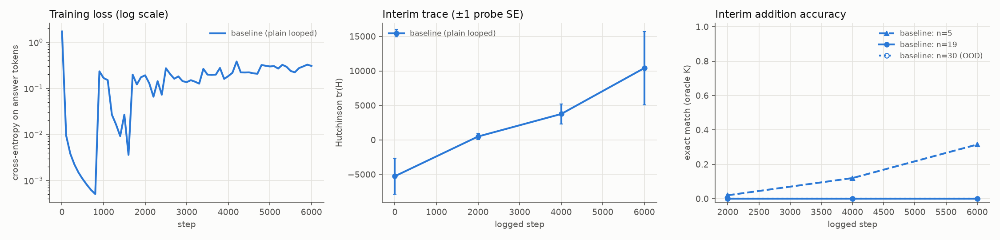

# Stage 1 experiment record

**Question.** Does an intermittent stochastic Hessian-trace penalty change longer-width binary-addition accuracy for a matched pair of looped transformers? The unit observed by this pilot is one pair of training runs. [Registration and amendments](preregistration.md) · [Scientific audit](reviews/2026-11-26-scientific-audit.md)

<!-- BEGIN:headline -->
**Stage 1 accuracy comparison and final trace check are unevaluated.** The baseline history ends at logged step 6,000 of a 30,000-step budget and includes interim accuracy checks. No Hutchinson run is recorded.
<!-- END:headline -->

## Run matrix

| Run | Training | Role |
|---|---|---|
| Baseline | Full-batch token-mean cross-entropy, clipped gradient and AdamW | Reference learning curve and final accuracy |
| Hutchinson | Same base loss and optimizer; on scheduled steps add a probe gradient measured on the first four problems | Intervention on training |
| Shared initialization | Evaluate the initial weights under the same stopping rules when pairing is supported | Untrained control |
| Fair bits with supplied EOS | Analytic single guess for the sum bits | Reference for fixed-depth exact match |

The registered width, depth, curriculum, seed and optimizer settings are in the [resolved baseline configuration](../results/stage1_baseline/config.json). The sub-batch Hessian uses its own token denominator. The penalty schedule and coefficient were chosen before completed Stage 1 evaluations. See [method derivations](../docs/methods.md) and [original timing artifacts](../results/benchmark/).

## Final and interim measurements

<!-- BEGIN:audit_interim -->
Archived baseline interim oracle accuracy (%), 200 problems per monitored width.

| Logged step | n=5 | n=10 | n=15 | n=19 | n=20 | n=30 | n=40 |
|---:|---:|---:|---:|---:|---:|---:|---:|
| 2,000 | 2.0 | 0.0 | 0.0 | 0.0 | 0.0 | 0.0 | 0.0 |
| 4,000 | 12.0 | 0.5 | 0.0 | 0.0 | 0.0 | 0.0 | 0.0 |
| 6,000 | 31.5 | 0.5 | 0.0 | 0.0 | 0.0 | 0.0 | 0.0 |
<!-- END:audit_interim -->

<!-- BEGIN:results_table -->
Final accuracy measurements pending.
<!-- END:results_table -->

<!-- BEGIN:figures -->

<!-- END:figures -->

<!-- BEGIN:per_length_table -->
Per-length final scores pending.
<!-- END:per_length_table -->

<!-- BEGIN:curvature_table -->
Curvature measurements pending.
<!-- END:curvature_table -->

<!-- BEGIN:loop_table -->
Loop-count study pending.
<!-- END:loop_table -->

<!-- BEGIN:examples_table -->
Final output examples pending.
<!-- END:examples_table -->

## Interpretation

The final oracle is a per-length, label-selected diagnostic. The fixed K=n rule is prespecified. Probe SE conditions on the fitted model and one measurement batch; only additional independent seed pairs address training variability. The independent audit reconstructs the smoke test, the benchmark projection and the CPU operator discrepancy, and describes which older hardware and gradient-mechanism claims lack the necessary raw evidence. [Detailed evidence ledger](reviews/2026-11-26-scientific-audit.md) · [Rebuild instructions](../README.md#reproduce-the-audit)
